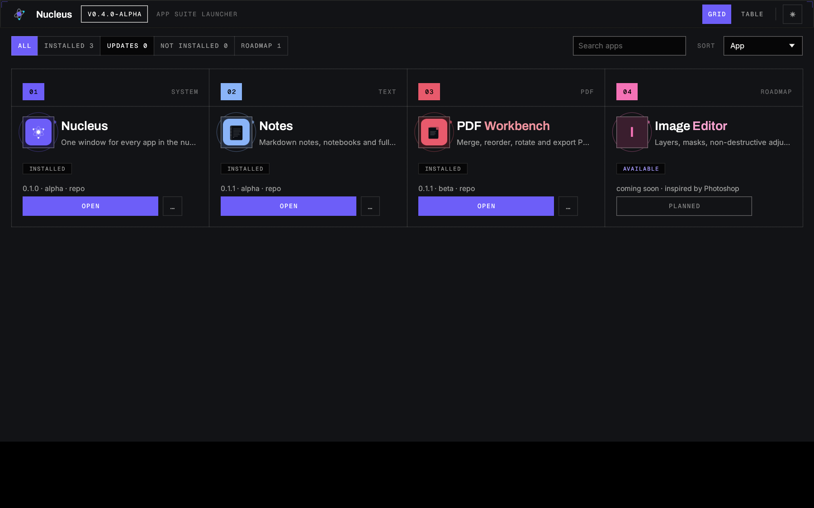
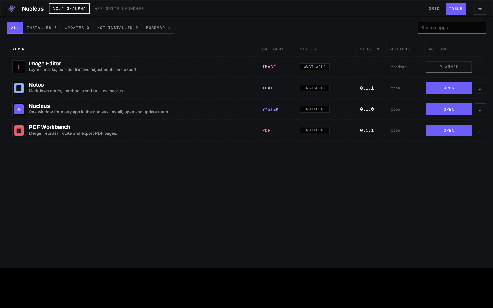
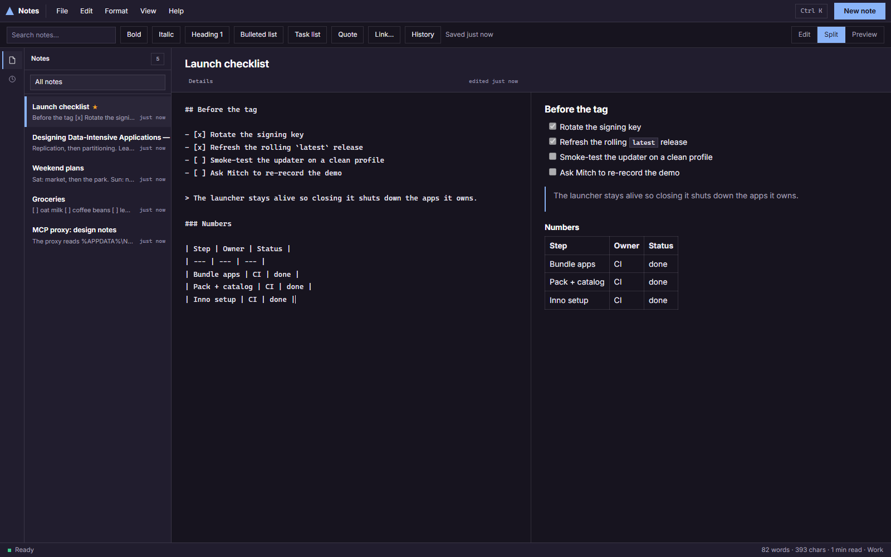

<div align="center">

# Nucleus

### The creative suite that runs itself.

*A native Rust launcher, drop-in plugins in WebView2 windows — no Electron, no bundled runtime.*
*One command bus: every app speaks GUI, CLI and MCP.*

[](https://github.com/Skeabby/nucleus/actions/workflows/ci.yml)
[](https://github.com/Skeabby/nucleus/actions/workflows/launcher-rs.yml)
[](./LICENSE)
[](#)
[](https://nodejs.org)
[](https://github.com/Skeabby/nucleus/stargazers)


<br />

<br />


</div>

---

Nucleus hosts small creative apps as plugins, and every app exposes **one command bus** through a
web UI, a CLI and an MCP server. Drive it by clicking, scripting, or prompting — the results are
identical. A federated MCP surface can drive several apps in one session with a **single undo
stack**.

> **The GUI, the terminal, and your AI agent all run the exact same commands.**

## Highlights

- **Apps are just folders.** Drop a directory with a `nucleus.app.json` manifest into `apps/` and it
  appears in the launcher. No registry, no rebuild, no plugin SDK to learn.
- **Agent-first, not agent-bolted-on.** MCP is a first-class frontend: an AI agent can do everything
  a human can, because it talks to the *same* command bus — discovering commands
  (`cmd_list` / `cmd_describe`), invoking them (`cmd_invoke`), with one shared undo stack in session.
- **Apps install themselves, verified.** A `.nucleusapp` archive is SHA-256 checked, unpacked to a
  temp directory, verified **file by file** against a digest ledger , then swapped in atomically with rollback: zip-slip, decompression bombs and case-collisions
  are all refused. The launcher does the whole loop itself: `--pack`, `--gen-catalog`,
  `--install-app` / `--uninstall-app`, and the Install / Update / Remove buttons in the UI.
- **A native launcher, no Electron.** `launcher-rs/` is a single Rust binary  with manifest discovery, Open / Stop, grid and table views,
  category filter, search, dark/light themes, a smoke-test CLI — and a flat hairline design of its
  own: brand violet reserved for the chrome, orbit icon tiles, corner brackets.
- **One core to rule the suite.** `@nucleus/core` owns the document model, the command bus and
  undo/redo. Frontends are thin adapters, so a feature lands once and is available everywhere.
- **Measured claims, or none.** [`docs/scoreboard.md`](./docs/scoreboard.md) is generated from real
  command output; CI fails if it drifts from the code. Every number in this README has a command
  behind it. There is also a cross-app demo that an agent replays end to end .

## Apps

| App | Status | What it does |
|-----|--------|--------------|
| **Nucleus launcher** | alpha | The **native Rust launcher** (`launcher-rs/`): every app in one window — grid and table views, category filter, search, Open / Stop, live log, dark + light themes, its own flat hairline design. |
| **PDF Workbench** | beta | Merge, reorder, rotate, delete pages, undo/redo, save/open projects, export. |
| **Notes** | beta | Markdown notes with notebooks, tags, pin/favorite, trash + restore, full-text search, split preview, quick open, command palette and Markdown export. |
| Image Editor | planned | Layers, masks, non-destructive adjustments and export. |

Two launchers ship: the **native Rust one** above is the default entry point, and the TypeScript
launcher (`apps/launcher` + `packages/launcher`) from the v0.1.0 days stays in the repo as the
reference implementation over the same `nucleus.app.json` files.

## Install

Grab the [Latest release](https://github.com/Skeabby/nucleus/releases/latest) — one download, no
admin prompt, done.

1. **Run the installer** (`NucleusSetup-<version>-win64.exe`). It is a per-user install and needs no
   administrator rights. Start-Menu and desktop shortcuts are created by default (untick the
   desktop-shortcut box during setup if you do not want it).
2. **Launch Nucleus** from the Start Menu or the desktop shortcut, pick an app and click **Open** —
   it starts on a free port in its own native window.
3. **To remove it**: **Settings → Apps → Nucleus → Uninstall**, or run
   `powershell -ExecutionPolicy Bypass -File scripts\uninstall-nucleus.ps1`.

> **Node.js note:** the *launcher* is a native binary and needs nothing else. The *apps* it hosts
> are Node servers, so Node.js must be on your `PATH` — install it once from
> [nodejs.org](https://nodejs.org). The installer only *warns* if it is missing; it never blocks.

Prefer not to install anything? The portable `nucleus-launcher-<version>-win64.zip` in the same
release runs `nucleus-launcher.exe` from wherever you unzip it.

A released launcher runs **catalogue-only** with no checkout: it discovers installed apps under
`%APPDATA%\Nucleus\apps` and installs published app bundles from the catalogue, so it works on a
machine that has never seen this repository. Close the launcher window to shut down the apps it
owns.

<details>
<summary><strong>Run from a checkout (developers)</strong></summary>

The launcher is the native Rust binary; the apps it hosts are Node/TypeScript, so build the apps
once. Full setup lives in [CONTRIBUTING.md](./CONTRIBUTING.md):

```powershell
npm install
npm run build
cargo build --release --manifest-path launcher-rs\Cargo.toml
.\launcher-rs\target\release\nucleus-launcher.exe   # run from the repo root
```

Make a checkout act like a desktop app:

```powershell
npm run shell                                     # once — build the native window shell
powershell -File scripts\install-shortcut.ps1     # "Nucleus.lnk" on the desktop, with an icon
```

</details>

## How it works

```
  frontends
    launcher UI          click it
    control-cli          script it
    control-mcp          prompt the apps the launcher is running
    control-federation   prompt every app in one session, one undo stack
                                │
                                ▼
                    ControlServer (transport-agnostic)
                                ▼
        CommandBus · document model · undo/redo · serialization
                                ▲
                app command packs (e.g. @nucleus/pdf)
```

The **launcher** scans `apps/*/nucleus.app.json` and `%APPDATA%\Nucleus\apps`, picks a free port
per app, spawns `node <app>` detached with a `PORT` env var, waits for a readiness probe, and opens
a native window at the app root. It stays alive so closing the launcher shuts down the apps it
owns.

## Monorepo layout

```
packages/core              # document model, command bus, undo/redo, serialization
packages/control           # ControlServer: invoke / describe / list / history
packages/control-cli       # CLI frontend
packages/control-mcp       # MCP frontend (dependency-free JSON-RPC 2.0 over stdio)
                           #   proxy over run/apps.json → each app's /api/* with its bearer
packages/control-federation # MCP frontend across apps: one session, one undo stack
packages/control-rpc       # planned JSON-RPC frontend — README only, no code yet
packages/pdf               # @nucleus/pdf command pack (import / rotate / move / remove / export)
packages/notes             # @nucleus/notes command pack (commands, views, markdown export)
packages/launcher          # app discovery, manifests, process runtime, windows, CLI
apps/launcher              # the launcher window (grid/table UI + /api/apps)
apps/pdf-workbench         # app #1: local HTTP server + web UI
apps/notes                 # app #2: Markdown notes on the command bus
schemas/                   # JSON Schema - the source of truth for codegen
tools/                     # codegen, schema validators, scoreboard
shell/                     # native window host (WinForms + WebView2)
scripts/                   # shell build, installer, release build, screenshots, shortcuts
launcher-rs/               # native Rust launcher: core crate + egui/eframe UI crate
```

Every app is just a folder with a `nucleus.app.json` manifest describing what it is and how to
launch it — that is all the launcher needs to discover and run it.

## Commands

```bash
npm run verify            # build + typecheck + test (via turbo) + cross-app demo
npm run test
npm run scoreboard        # regenerate docs/scoreboard.md from real command output
npm start                 # open the Nucleus launcher
npm run nucleus -- list   # list discovered apps
npm run nucleus -- open nucleus.pdf-workbench
npm run mcp               # run the per-app MCP server over stdio
npm run mcp:federation    # run the cross-app MCP server over stdio
npm run demo:cross-app    # replay the two-app session and its unified undo
```

The native launcher is a cargo workspace (`launcher-rs/`). From that directory:

```bash
cargo test                                   # unit tests (core + launcher)
cargo run --release -p nucleus-launcher -- --smoke      # headless smoke test (apps + planned + node)
cargo run --release -p nucleus-launcher -- --list       # discovered vs planned apps
cargo run --release -p nucleus-launcher -- --install-app <id>   # catalogue install
cargo run --release -p nucleus-launcher -- --pack apps/notes --out notes.nucleusapp
cargo run --release -p nucleus-launcher -- --gen-catalog mirror/apps --out mirror/catalog.json
cargo run --release -p nucleus-launcher      # open the native window
```

## Agent-ready (MCP)

Two MCP servers are registered in [`.opencode/mcp.json`](./.opencode/mcp.json) — see
[`.opencode/README.md`](./.opencode/README.md):

- `nucleus` — `control-mcp`: a **proxy** over the launcher's run registry. It finds the apps that are
  actually running (`run/apps.json`), talks to each one over HTTP with its bearer token, and exposes
  `nucleus_apps`, `nucleus_describe`, `nucleus_invoke`, `nucleus_proposals`, `nucleus_wait`,
  `nucleus_tape`, `nucleus_undo` plus curated shortcuts for descriptors that opt in with `mcp.expose`
  (`note_create`, `pdf_remove_page`, …). Agents land in the review drawer; the tape records the actor.
  See [`examples/mcp/transcript.md`](./examples/mcp/transcript.md) for a full run.
- `nucleus-federation` — `control-federation`: every joined app in one session, with a **single undo
  stack** across them (`apps_list`, `cmd_list`, `cmd_describe`, `cmd_invoke`, `state_get`,
  `undo_status`, `undo`, `redo` + each app's tools). Details in
  [`docs/cross-app.md`](./docs/cross-app.md).

Any MCP-capable agent can drive the same command bus as the GUI, so the whole suite is scriptable
*and* promptable.

## Roadmap

The phased plan, design decisions and risks live in [`ARCHITECTURE.md`](./ARCHITECTURE.md).

Where we are: the native Rust launcher + the first two apps, cross-app federation, and the full
`.nucleusapp` catalogue loop — bundle builder, catalogue generator, verified install / update /
remove in both the CLI and the UI, with an offline (no-network) test — **shipped, and available as
the [Latest release](https://github.com/Skeabby/nucleus/releases/latest)**. The committed catalogue
already points at two published app bundles
([`apps-v0.1.0`](https://github.com/Skeabby/nucleus/releases/tag/apps-v0.1.0)), so a released
launcher installs them on a machine with no checkout.

Next: harden the core (typed command schemas, document-version CAS, transactions, dry-run), build
the **Image Editor** (the second proof app), the JSON-RPC frontend and packaging for cross-platform
native bundles.

## Contributing

PRs and issues are welcome — this is a young project and the plugin/manifest model is the most
interesting thing to poke at. [`CONTRIBUTING.md`](./CONTRIBUTING.md) has the full setup, the
repo's rules and every verification gate; in one line: run `npm run verify` before opening a PR.

If Nucleus is useful or just neat, a **star** helps other people find it.

## License

[MIT](./LICENSE) © Nucleus contributors.

### Bundled third-party assets

The native launcher (`launcher-rs/`) embeds three typefaces, all under the SIL Open Font License
1.1. The full licence texts ship alongside the font files in
[`launcher-rs/crates/nucleus-launcher/assets/fonts/`](./launcher-rs/crates/nucleus-launcher/assets/fonts):

| Font | Licence | Copyright |
| --- | --- | --- |
| Archivo | OFL 1.1 (`OFL-Archivo.txt`) | 2020 The Archivo Project Authors (Omnibus-Type) |
| Inter | OFL 1.1 (`OFL-Inter.txt`) | 2016 The Inter Project Authors |
| Geist Mono | OFL 1.1 (`OFL-GeistMono.txt`) | 2024 The Geist Project Authors (vercel/geist-font) |

No other third-party code or design assets are used: the launcher UI is an original implementation.
